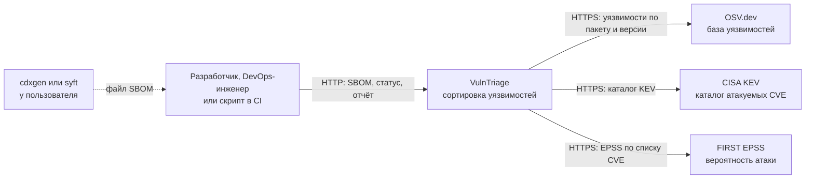
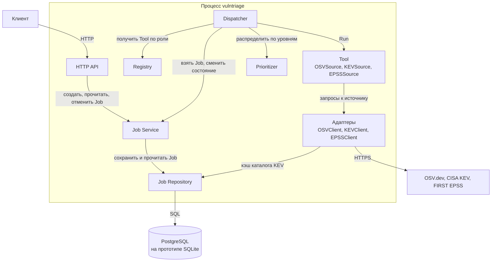
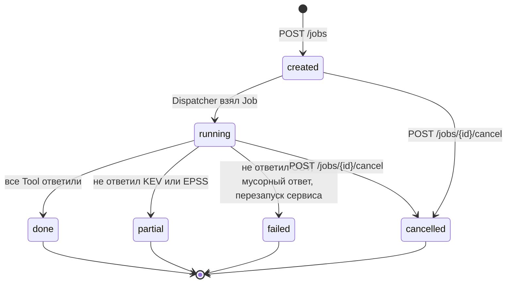

# Архитектура VulnTriage

## Контекст

Сплошные стрелки показывают сетевые вызовы. Стрелка идёт от того, кто начинает запрос. Пунктир показывает передачу файла вне системы: SBOM пользователь делает своими инструментами и потом отправляет нам.

| Участник | Роль |
|---|---|
| Разработчик, DevOps-инженер, скрипт в CI | отправляет SBOM, забирает отчёт, может отменить проверку |
| OSV.dev | отвечает, какие уязвимости есть у пакета нужной версии |
| CISA KEV | список CVE, которые уже атакуют |
| FIRST EPSS | вероятность атаки на CVE в ближайшие 30 дней |

## Компоненты

Стрелки показывают вызовы во время работы, от вызывающего к вызываемому. Зависимости кода идут так же, с одним отличием. Job Service, Dispatcher и Prioritizer образуют ядро и знают только интерфейсы `Tool` и `JobRepository`. Конкретные реализации подставляются при запуске в `main`, поэтому ядро не зависит ни от HTTP, ни от базы, ни от внешних API.

| Компонент | Отвечает за | Скрывает от соседей |
|---|---|---|
| HTTP API | разбор запроса, проверку SBOM и параметров, ключ идемпотентности, единый формат ошибок | HTTP, коды ответов, формат JSON |
| Job Service | создание Job, правила переходов состояний, отмену | таблицу разрешённых переходов |
| Dispatcher | берёт Job в работу, запускает Tool по ролям, решает итоговое состояние | порядок запуска, параллельность, таймауты |
| Registry | список зарегистрированных Tool по имени и роли | какие именно Tool есть в системе |
| Tool | один источник данных, находит или дополняет уязвимости | логику конкретного источника |
| Prioritizer | ставит каждой находке уровень и причину | пороги CVSS и EPSS |
| Адаптеры | HTTP-запросы к OSV, KEV, EPSS, таймауты, повторы, разбор ответа | адреса, форматы и лимиты чужих API |
| Job Repository | хранение Job, отчётов, ключей идемпотентности, кэша KEV | SQL и выбор СУБД |

Запрос проходит так. HTTP API проверяет SBOM и через Job Service сохраняет Job в состоянии `created`. Dispatcher забирает его, запускает сначала Tool с ролью Finder (OSV), потом Tool с ролью Enricher (KEV, EPSS), отдаёт находки Prioritizer и сохраняет отчёт.

## Жизненный цикл Job

`done`, `partial`, `failed` и `cancelled` конечные. Повторная проверка всегда создаёт новый Job через `POST /jobs`, прежний Job и его отчёт остаются без изменений.

### Запрещённые переходы

| Попытка | Откуда может прийти | Ответ системы |
|---|---|---|
| отменить Job в `done`, `partial`, `failed` или `cancelled` | `POST /jobs/{id}/cancel` | `409 invalid_transition`, состояние не меняется |
| вернуть конечный Job в `running` | операции в API нет; внутри кода | `Job.Transition` возвращает `ErrInvalidTransition`, запись в лог с correlation ID |
| `running → created` | внутри кода | то же, `ErrInvalidTransition` |
| `created → done`, `created → partial`, `created → failed` в обход `running` | внутри кода | то же, `ErrInvalidTransition` |

При запуске сервис переводит все Job, оставшиеся в `running`, в `failed` с кодом ошибки `interrupted`. Это единственный переход, который делается не Dispatcher.
